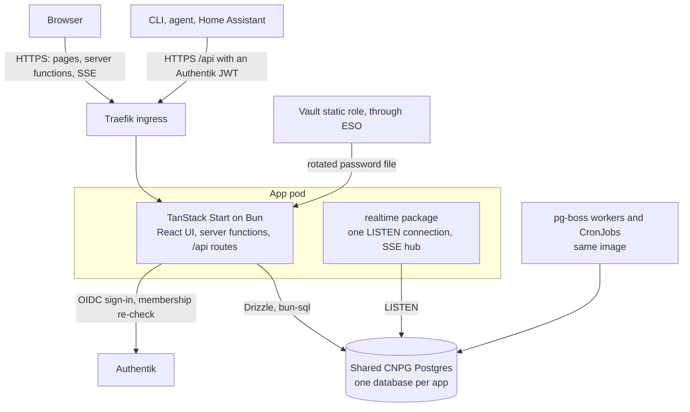
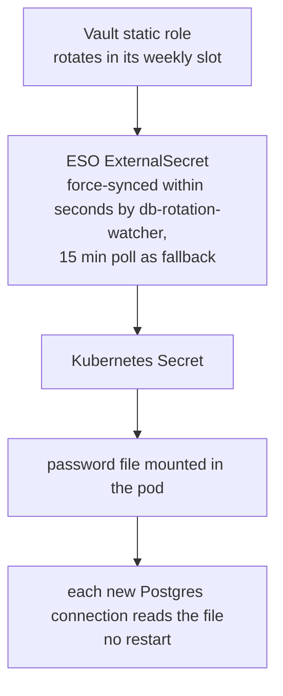
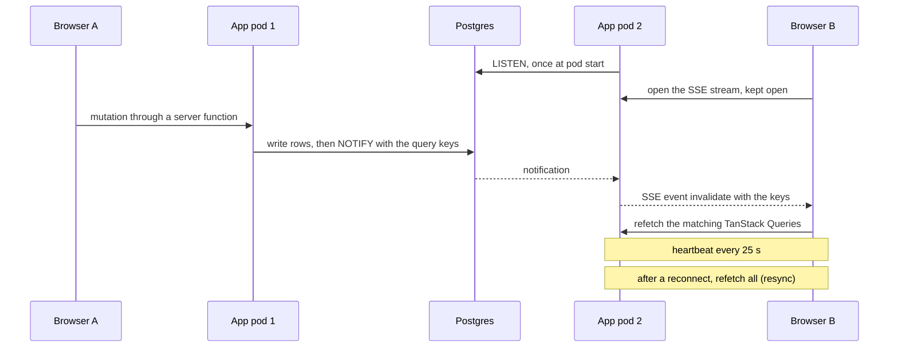
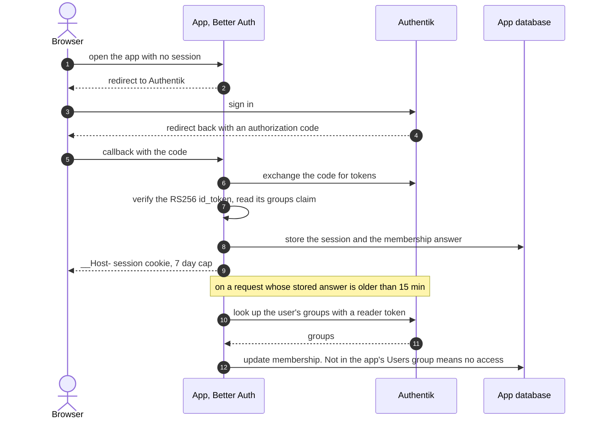
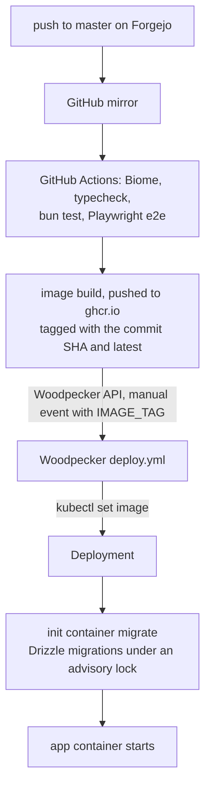
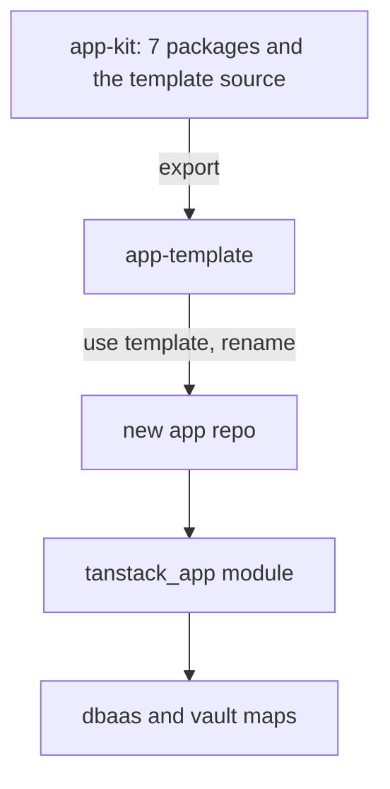

# ADR-0001: Default stack for new apps: TanStack Start, Drizzle on the shared Postgres, Authentik accounts

> [!NOTE]
> Revised on 2026-10-16 after a five-lens review panel (security, operations,
> pilot, toolchain, coherence). This version supersedes the first draft of the
> same day, including any brief or summary written from it.
>
> Moved on 2026-11-03 from the `~/code` monorepo root (`docs/adr/0001-default-app-stack.md`)
> to app-kit, which holds the shared packages and template this ADR asks for.
>
> On 2026-11-09 [ADR-0002](0002-otel-log-fields-and-telemetry.md) replaced the
> log line under Delivery, Shared code: logs now use OpenTelemetry field
> names, and new apps have telemetry on by default.

## Context

New first-party apps in the `~/code` workspace have been built several ways. Today there
are 11 SvelteKit frontends, about 8 React + Vite single-page apps (three of them
on TanStack Query), one Next.js app and one Solid app. Behind them sit about 30
Python projects, most of them FastAPI, and 4 Go daemons. A typical web app is a
FastAPI process serving a static SPA, with types hand-mirrored between the two
(tripit carries about 2,800 such lines).

A stack evaluation on 2026-07-08 recommended FastAPI + SvelteKit for web apps.
It compared against Next.js / T3, it lived only in agent memory, and it was
never ratified. TanStack Start reached a stable 1.0 on 2026-10-12, which made a
server-side TypeScript stack worth evaluating again.

Viktor's goals for the default stack:

- one language from the database to the UI
- less code per app
- realtime UI by default
- fewer moving parts to operate

Constraints carried over from the platform: everything is self-hosted at no new
cost; every app exposes an HTTP API for CLIs, agents and Home Assistant; and app
users include the household, invited friends and members of the public.

## Decision

New apps use the stack below. Existing apps keep their current stack and move
only when a large rewrite is due anyway. One existing app, `tasks`, is ported
as the pilot.

### Language and framework

| Area | Default |
|---|---|
| Language | New apps are TypeScript, UI and backend. A new component inside an existing app follows that app's stack. Python only for numeric or ML work (the numpy / sklearn class). Platform tooling, such as the Go `homelab` CLI and infra exporters, may stay Go. |
| App framework | TanStack Start, React flavour, with shadcn/ui components. |
| Runtime | Bun, pinned with `"packageManager": "bun@1.4.3"` in every app. The same version is installed by `infra/playbooks/devvm.yml` (the devvm has 1.3.11 today, which cannot read a 1.4.3 `bun.lock`), by `oven-sh/setup-bun` in CI, and used as the Docker base. The server is built with Nitro's `bun` preset; a test build on 2026-10-16 ran at 46 MB RSS. |
| Image | Build on `oven/bun:1.4.3`, run on `oven/bun:1.4.3-distroless` as `USER 10001:10001`, copying only `.output` plus the job and migration entrypoints. |
| Tests | `bun test` with happy-dom and Testing Library for logic and components (`[test] root = "src"`, `NODE_ENV=test`). Server functions are tested over HTTP against the built server, because they need Start's request context. Playwright for end-to-end tests, outside `bun test`'s root. |
| Lint | Biome. Biome has no equivalent of the TanStack Query lint plugin, so apps build query keys through a query-key factory. |
| Agent docs | Each app's `AGENTS.md` loads the agent skills that TanStack ships inside its npm packages (TanStack Intent), so agents read docs for the installed version, and opens with a warning that TanStack Start is not Next.js (no `getServerSideProps`, `"use server"` or App Router conventions). |

### Data

| Area | Default |
|---|---|
| Database | Drizzle on the shared CloudNativePG cluster with the `bun-sql` driver, which supports `LISTEN` and a password function. No database pod per app. |
| Provisioning | The database and role are still created in `stacks/dbaas` and the Vault static role in `stacks/vault`, as for every app today. The template adds one entry to a `for_each` map in each, instead of a hand-written resource. Vault rotates the role in a Tuesday `rotation_schedule` slot, the `db-rotation-watcher` CronJob in `stacks/vault` refreshes the ExternalSecret within seconds of the rotation (infra `docs/runbooks/db-credential-rotation.md`), and the app reads its password from a mounted file at connect time, so new connections pick up the new password without a restart. |
| Connection budget | At most 5 connections per app pod, with pg-boss sharing the app pool through its `db` option, and at most 2 per CronJob. On 2026-10-16 the primary had 110 of 200 connections in use and alerts fire at 85%. |
| Migrations | drizzle-orm's migrator runs once per deploy (init container or Job) under `pg_advisory_lock`, because the migrator takes no lock of its own. Migrations are additive (expand, then contract in a later release), so the previous image stays a working rollback. |
| Backups | The existing daily per-database `pg_dump` (RPO 24 hours, 14 days kept). The shared cluster has no WAL archiving, so there is no point-in-time recovery. |
| Realtime | A shared package. A Postgres trigger or a shared Drizzle mutation helper sends `NOTIFY`; each pod holds one `LISTEN` connection and relays events over one SSE endpoint; a client hook invalidates the matching TanStack Query keys. See the realtime contract below. |
| Background work | Kubernetes CronJobs and pg-boss workers, using entrypoints bundled with `bun build --target bun` into the same image (the Nitro output has no `node_modules`). pg-boss stores its queue in the app's database. |

How a rotated database password reaches a running pod:

**Realtime contract.** `NOTIFY` is not durable: an event sent while a listener is
reconnecting (a CNPG failover or restart, a pod restart, an SSE reconnect) is
lost. The package therefore:

- sends a "resync" event after every `LISTEN` reconnect, and the client
  invalidates all active queries after every SSE reconnect
- runs `SELECT 1` on the `LISTEN` connection every 30 seconds and reconnects on
  timeout, so a half-open socket is noticed
- sends an SSE comment heartbeat every 25 seconds (public hosts go through a
  Cloudflare tunnel, which closes idle responses after about 100 seconds), with
  `Cache-Control: no-cache` and a `retry:` hint
- exports `realtime_listen_connected` and `realtime_last_notify_age_seconds`,
  and the platform alerts on `pg_notification_queue_usage()` above 50%, since
  the `NOTIFY` queue is shared by every database on the cluster

Apps that use the realtime package do not enroll in Sablier scale-to-zero
(infra ADR-0022) until SSE behaviour there is tested.

### Identity and access

| Area | Default |
|---|---|
| Accounts | Authentik is the account provider. The Terraform app module creates, per app, an OIDC application, its `<App> Users` group and the group binding in one resource graph, with `signing_key` set (otherwise Authentik signs HS256 and publishes an empty JWKS) and `sub_mode` set to `hashed_user_id`. Apps key users on `sub` and never authorize by email. |
| Default app access | Platform change: Authentik's `core_default_app_access` (live value `true` on 2026-10-16) is turned off, after the `Public` application gets an explicit allow binding. Until then, an application created without a binding admits every account until the next authentik plan catches it. |
| Sign-up | Each app picks one mode. **Open**: a per-app Authentik enrollment path skips the invite-code prompt and adds the person to `<App> Users`, with a Turnstile captcha stage in the shared social sign-up flow (sign-up happens on Authentik, so the app cannot host the captcha). **Request + approve**: generalised from f1-stream ADR-0042, with a pending page in the app and approval through a token that can only add users to that app's group. Both are platform work in `stacks/authentik`, built before the first app that needs them. |
| Sessions | Better Auth with its generic OAuth plugin and Drizzle adapter, sessions in the app's database. Access tokens are valid for 15 minutes at most, sessions have an absolute cap of 7 days, and each refresh re-checks group membership with Authentik, so removing someone takes effect within 15 minutes. When the Authentik session is the anonymous `guest`, the app sends `prompt=login`. |
| Browser security | Host-only `__Host-` cookies (several sites share `*.viktorbarzin.me`, including multi-user `pages`). An explicit CSRF middleware with the app's public origin covers server functions, cookie-authenticated server routes and the SSE endpoint. Better Auth `trustedOrigins` lists exact origins. |
| Admin | Admin authorization is checked inside each admin server function against an app admin group, separate from Home Server Admins. Forward-auth on `/admin` does not cover server-function calls, so it is not relied on. `/metrics` is served on the pod for in-cluster scraping and is not routed through the ingress. |
| Secrets | `BETTER_AUTH_SECRET` and the OIDC client secret live in Vault KV and reach the pod through ESO, separate from the rotated database password. Web sign-in does not request `offline_access`. |
| HTTP API | Non-browser clients use server routes under `/api` with schema validation and a generated OpenAPI document. Server functions are internal RPC for the app's own UI. |
| API tokens | Authentik-issued JWTs. The shared verifier pins `RS256`, the provider's issuer, `aud` equal to the app's client IDs (Authentik 2026.8.3 sets `aud` to `client_id`) and `exp`. People's CLIs use device-code login, which needs a brand device-code flow (not configured today) and per-provider `grant_types`. Agents and Home Assistant use service accounts placed in a per-app `<App> Agents` group, never in Home Server Admins. |
| User metrics | Accounts and logins per app from Authentik; in-app activity from the app's own database. |

Web sign-in and the membership re-check, as built in `@viktorbarzin/auth`:

### Delivery

| Area | Default |
|---|---|
| Shared code | Shared npm packages (auth setup, realtime, token verification, logging and metrics) published as public packages on npmjs.org under the `@viktorbarzin` scope, a free npm organisation (registry superseded by [ADR-0003](0003-forgejo-package-registry.md): apps install from Forgejo, npm is a mirror). The libraries live in public GitHub repos, pass a gitleaks scan before each release, hold no hostnames, client IDs or secrets, and are published from GitHub Actions with npm trusted publishing (provenance included, no tokens in consumers, no private Actions minutes). Builds therefore work with the homelab down, as infra ADR-0002 requires. The `@homelab` scope belongs to another npm user and is never used. Logging follows the existing JSON-lines contract (`ts`, `level`, `logger`, `msg`, plus extras; superseded by [ADR-0002](0002-otel-log-fields-and-telemetry.md), OpenTelemetry field names) and metrics use the `prometheus.io/*` scrape annotations. |
| Dependency updates | A separate Renovate job for app repos, with its own repo list and run limit, Bun available to update `bun.lock`, and OSV vulnerability alerts on. Updates land straight on master like infra, and the normal build runs afterwards. App repos wait 3 days before taking a new npm release (infra has no wait); our own packages are excluded. An urgent CVE fix is taken through an exact-version `minimumReleaseAgeExcludes` entry and a manual bump. Nothing waits for review (Viktor, 2026-10-18; until then TanStack Start and Router and the Bun pin were proposed for manual approval). TanStack Start and Router (`@tanstack/*start*`, `@tanstack/*router*`) are pinned to exact versions and land together in one commit; Start ships breaking changes in minor and patch releases, so the app CI's tests, which run before the deploy job, are what stops a breaking bump. The Bun runtime pin, the `oven/bun` base image and CI's `setup-bun` version land together in one commit. |
| Starting a new app | A template repo plus a reusable Terraform app module, extracted from the pilot. The module owns the Deployment, ingress, ESO secrets and the Authentik application; the database pieces are the map entries described under Provisioning. |

From a push to a running pod, as the template's `build.yml` and `.woodpecker/deploy.yml` do it:

### Convex as an exception

Convex is allowed for an individual app when the app is small, highly
collaborative (shared lists, chat, live boards) and does not need SQL access,
cross-app joins or reporting. Such an app records the choice in its own ADR.

### Relation to Cloud

The homelab and Cloud use one stack. The Cloud portal (cloud ADR-0001) had
chosen the T3 stack and planned one-click T3 templates. A comparison on
2026-10-16 found create-t3-app without a release since 2025-11-05 (it pins
Next 15 while Next is on 16.4), Auth.js handed over to Better Auth, our Next.js
pods at 153 to 685 Mi against 46 to 86 MiB for Start, and a REST/MCP API that
Start's server routes serve directly where T3 would need tRPC plus a REST layer.
Viktor's decision: Cloud adopts whichever stack the `tasks` pilot confirms as
the default, and the T3 parts of cloud ADR-0001 are superseded at that point.

## Pilot: port `tasks`

The pilot ports backend and UI together, with one cutover.

- **What it proves.** Auth, deployment, Drizzle on an existing schema, the
  template and the app module. It does not prove Postgres-backed domain data or
  trigger-driven realtime, because `tasks` keeps its data in Nextcloud CalDAV
  and Postgres holds only `connected_accounts` and `applied_ops`. The first new
  app with its data in Postgres proves those.
- **Realtime in the pilot.** An op sent through `tasks` pokes the same user's
  other open devices so they run a delta sync. Edits made in other CalDAV
  clients still arrive when a device launches, regains focus or comes back
  online, as today; the client has no polling interval to replace.
- **Size.** About 1,840 lines of backend logic (CalDAV engine, ops, ICS
  mapping, sync, recurrence, cursor), about 2,900 lines of Svelte UI rewritten
  in React, and about 3,100 lines of backend tests ported as the correctness
  oracle. Most of the 2,800 lines of frontend TypeScript logic carry over.
- **Data.** Reuse the existing database read-write. Drizzle's pulled baseline is
  marked as applied, `enc_app_password` is a hand-written `bytea` custom type
  (drizzle-kit cannot introspect `bytea`), `updated_at` uses `$onUpdate`, and
  `tablesFilter` excludes `alembic_version`. Migrations stay additive until the
  old image is retired as a rollback target, because it runs `alembic upgrade
  head` on every start.
- **Identity.** Existing rows are keyed by `authentik_username` from the
  forward-auth header. At cutover each row is mapped to the user's OIDC `sub`
  (matching on `preferred_username` once). `Tasks Users` is seeded with the
  household members who already have a Connected Account, so they skip
  request + approve.
- **Client continuity.** The IndexedDB name, version and stores and the op wire
  format are a frozen contract, because the React build inherits the Svelte
  build's origin, service worker and queued offline ops. A cutover test queues
  ops offline on the old build, swaps the image and checks they drain. The auth
  edge cases settled in `tasks` ADR-0003 and ADR-0004 (service-worker precache
  of the sign-in navigation, auth-wall detection, re-login) are acceptance
  criteria, now detected by 401 instead of `opaqueredirect`.
- **Ports, not libraries.** Fernet is implemented on `node:crypto` (about 40
  lines) and tested against the Fernet spec vectors and a token from the live
  key format, in both directions. The CalDAV engine is ported by hand with an
  injectable transport, starting from `fake_caldav`. ICS and recurrence use
  `ical.js`, with the recurrence and ICS mapper tests ported as property tests.
- **Cutover.** The TypeScript build runs at a second host against the same
  database, limited to one test user while comparing, with its own entry in the
  `tasks` NetworkPolicy. Both ingresses carry `strip-auth-headers`, because the
  old image trusts `X-authentik-username`. Rollback is the old image together
  with its ingress back on `auth = "required"`, never the image alone.
- **Retired, 2026-10-16.** At Viktor's request the Python/Svelte build was
  retired on the day of the cutover rather than kept as a rollback target, so
  a rollback is now a restore from git history. The TypeScript build runs as
  Deployment `tasks` from the ghcr package `tasks`, and tasks-next is gone.
  With no Alembic-running image left, migrations no longer need to stay
  additive for the old image's sake.

### Pilot outcome, 2026-10-17

Viktor signed in on the new build, found it worked the same, and confirmed this
stack as the default for new apps from 2026-10-17. Cloud therefore adopts it
too (see "Relation to Cloud").

| | Python/Svelte build | TypeScript build |
|---|---|---|
| Languages | Python and TypeScript | TypeScript |
| Identity | forward-auth header trusted by the app | app-side OIDC; a forged header gets 401 |
| Realtime | sync on launch, focus and online | SSE poke, about 120 ms between devices in the integration run |
| Code, excluding tests | 8.7k lines | 15.2k lines |
| Downtime per deploy | Recreate | Recreate, about 17 s measured |

About 2.3k of the 15.2k lines are capability the old build did not have (auth
1.8k, realtime 0.5k). The rest is a close port with parity guards, metrics and
lifecycle handling, so the pilot did not meet the "less code per app" goal on
its own. The shared `@viktorbarzin` packages are expected to carry auth,
realtime, token verification, logging and metrics for the next app; tasks moves
onto them when they exist.

What the pilot did not exercise: Postgres-backed domain data, pg-boss, and an
app behind Sablier.

### Shared packages and template, 2026-10-17

| Piece | Where | State |
|---|---|---|
| Packages: log, runtime, metrics, pg, oidc-token, auth, realtime (0.1.0) | `viktor/app-kit` on Forgejo, mirrored to GitHub `ViktorBarzin/app-kit` | CI green; release workflow builds and runs a dry run; nothing on npm yet |
| Template | source in `app-kit/template`, exported to `viktor/app-template` | 5 Playwright e2e tests pass (sign-in, access request, two-tab realtime, LISTEN resync); the exported repo's CI stops at a "publish packages first" check until npm has the packages |
| App module | infra `modules/kubernetes/tanstack_app`, checklist in infra `docs/agents/new-app.md` | tasks runs on it; the move planned and applied as 0 added, 0 changed, 0 destroyed, with the pod untouched |
| Database maps | `stacks/dbaas` `app_databases`, `stacks/vault` `pg_app_roles` | tasks is the first entry |

The packages went on npm the same day. Each had one manual first publish,
because npm accepts a trusted publisher only for a package that already exists.
Trusted publishers now point at repo `ViktorBarzin/app-kit`, workflow
`release.yml`, environment `npm-publish`, with direct publish allowed. npm's
trust API requires a `permissions` field that npm 11.12 does not send, so the
publishers were added with npm 12.2 (`npm trust github ... --allow-publish`).
The template was exported again with its `bun.lock`, and its CI passes against
the published packages. A release through trusted publishing has not run yet;
the first version bump will exercise it.

All seven packages are set to require two-factor authentication and refuse
tokens for publishing (`npm access set mfa=publish`); trusted publishing still
works with that setting. No npm credential is kept on the devvm. Agents change
the packages, bump versions and release them without asking first, then move
the apps onto the new versions. npm asks for Viktor's passkey on every account or
package-settings change, including from tokens set to bypass 2FA since
2026-07-31, so a new package, a deprecation, or a dist-tag, access or trust
change still needs one approval from him.

tasks then moved onto the packages:

| | Before | After |
|---|---|---|
| Code, excluding tests | 14,474 lines | 11,846 lines |
| Metric names | 40 | the same 40 |
| Session cookie | `__Host-tasks.session_token` | unchanged |

The line counts use one command for both (`src`, `.ts`/`.tsx`, no tests, no
generated route tree), which gives a lower figure than the 15.2k above. The
browser realtime client stays in tasks, because the package client handles
`invalidate` and `resync` events and tasks uses `poke`.

tasks stays on Vault `rotation_period` for now. Switching it to
`rotation_schedule` plans as an in-place update, and a plan cannot show whether
Vault rotates the password on apply, so that switch is a separate change made
outside the rotation hour. New apps from the template start on
`rotation_schedule`.

## Considered options

**Convex as the default database.** Convex gives reactive queries and the least
code per feature. Two independent reviews and a local test run on 2026-10-16
found these costs for a self-hosted default:

- One backend process serves exactly one deployment, so every app needs its own
  Convex pod (about 75 MiB idle, up to about 1 GiB under load in issue #563).
  There is no shared multi-app mode.
- Images are tagged by git SHA only, the self-hosted changelog stopped in
  September 2025, and each upgrade runs a one-way internal migration.
- Data is stored in Postgres as opaque `bytea` documents, so SQL access and
  joins across apps are not available.
- The default pool of 128 connections per backend is large next to the shared
  cluster's `max_connections` of 200.
- It would be a second database system beside the roughly 39 Postgres databases
  that stay.

Viktor's preference is to follow the shared Postgres architecture, which
Drizzle on CNPG does with no extra pod per app.

**ElectricSQL + TanStack DB for realtime.** This adds row-level sync and offline
support, but needs a replication slot and a sync pod per app. With
`max_slot_wal_keep_size` unlimited on the shared cluster, a stalled consumer
could retain WAL until the shared volume fills. TanStack DB is also still 0.x.
It remains the upgrade path for an app that needs local-first behaviour.

**App-owned accounts (tripit ADR-0028).** tripit moved outside users from
Authentik enrollment to app-local accounts in June 2026, because each outside
user became a homelab-wide identity that every OIDC app had to fence. Since
then the platform added an access-binding guard (`stacks/authentik/app-access-guard.tf`),
per-host default-deny forward-auth (infra ADR-0031), a Vault OIDC fence, invite
codes and the f1-stream request-and-approve flow. With those in place, and with
`core_default_app_access` turned off, Authentik as the single account provider
gives one place to see, group and disable users.

**Solid or Svelte instead of React.** Solid is the smallest and fastest
candidate and TanStack Start supports it, but Convex and component libraries
for it are thin, and agents tend to write React habits into Solid code. Svelte
has good tooling but no TanStack Router or Start. React has the most agent
training data, full TanStack and component support, at a larger bundle (about
69 KB gzipped for a counter app against 5 KB for Solid).

**Node and npm instead of Bun.** Node is the more common TanStack Start
deployment target. Viktor chose Bun; TanStack Start documents a Bun deployment
path, the Nitro `bun` preset built and ran in a test, and Bun supports a
minimum release age for installs.

**A phased pilot.** The review panel suggested porting the backend first behind
the unchanged API, keeping the Svelte UI, and proving realtime on a second app.
Viktor chose a single cutover.

## Consequences

- New apps are one language end to end, and browser clients lose the
  hand-mirrored API types. Non-browser clients use the generated OpenAPI
  document.
- New moving parts: Better Auth tables and a pg-boss schema in each app
  database, a public npm organisation, a second Renovate job, a pinned Bun
  toolchain on the devvm and in CI, and an Authentik application, group and
  enrollment path per app. What goes away for new apps: the FastAPI process
  beside a static SPA, and hand-mirrored types.
- Two migration tools remain for a while on one database: drizzle-kit for new
  apps and Alembic for existing Python apps.
- The realtime package is invalidate-and-refetch. Offline sync and optimistic
  updates are written per app where needed (TanStack Query `onMutate`).
- Platform work comes first: the Open and Request + approve flows, the
  Turnstile captcha stage, turning off `core_default_app_access`, a device-code
  flow, the second Renovate job and the `for_each` maps in dbaas and vault.
- The npm dependency tree is larger than today's Python one. The 3-day release
  wait in Bun and Renovate is the main guard; in May 2026, 84 malicious
  `@tanstack/*` versions were published and harvested credentials.
- TanStack Start ships breaking changes in minor versions. Start and Router are
  pinned and upgraded by hand; other npm updates land ungated, so a breaking
  release elsewhere can reach master before the build fails.

## Open questions

- Whether pg-boss runs cleanly on Bun with TanStack Start. Better Auth and
  prom-client's default metrics did in the `tasks` pilot (answered 2026-10-17).
- Answered 2026-10-17: per-provider `grant_types` needed provider 2026.5.0 or
  later; the pin moved to 2026.8.0 on 2026-10-16 and `tasks` sets it.
- Whether a long-lived SSE request refreshes a Sablier session (`tasks` is not
  behind Sablier, so the pilot did not answer it).
- Where Authentik's per-application login counts can be read for metrics
  (events API, logs in Loki, or an exporter).
